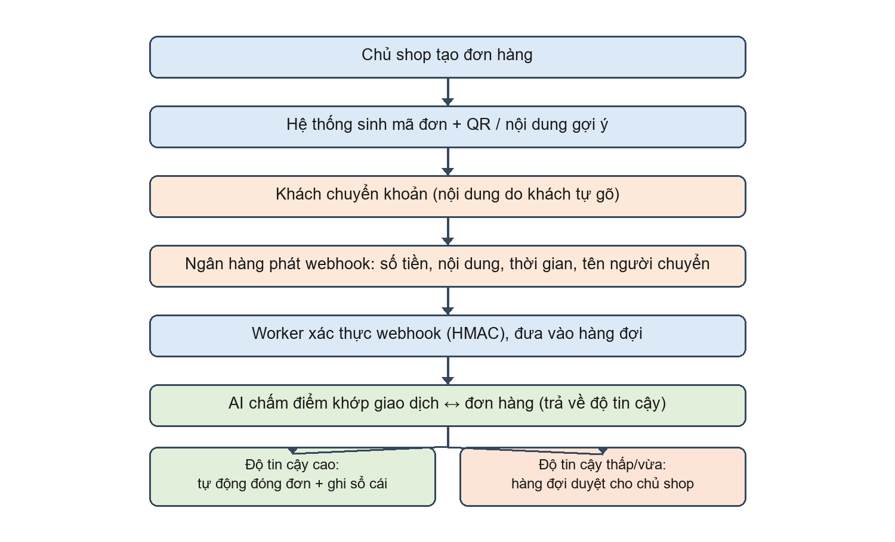

> Bản phác thảo chi tiết gửi giảng viên hướng dẫn (Nguyễn Đức Hiếu), ngày 17/10/2026, cập nhật 27/10/2026.
> Đây là nguồn tham chiếu về **phạm vi và thiết kế** của repo. Bản tóm tắt các quyết định đã khóa nằm trong `AGENTS.md`.

**PHÁC THẢO CHI TIẾT HƯỚNG LÀM ĐỒ ÁN TỐT NGHIỆP**

**Xây dựng hệ thống đối soát thanh toán chuyển khoản cho shop nhỏ**

(Hệ thống đối soát giao dịch – "cash application" cho người bán hàng online tại Việt Nam)

Sinh viên thực hiện: Nguyễn Chung Nguyên

Lớp / Khoá: CT7A

Giảng viên hướng dẫn: Nguyễn Đức Hiếu

Thời gian thực hiện: khoảng 6 tháng (dự kiến từ cuối tháng 10/2026 đến tháng 4/2027)

Ngày lập: 17/10/2026 (cập nhật 27/10/2026)

## 1. Đặt vấn đề và nhu cầu thực tiễn

Theo quan sát ban đầu, tại Việt Nam có khá nhiều shop nhỏ và người bán hàng cá nhân bán qua mạng xã hội (Facebook, Zalo, TikTok) và nhận thanh toán bằng chuyển khoản ngân hàng. Với những người bán này, giữa "tiền vào" và "đơn hàng" không tồn tại sẵn một liên kết nào: khách tự mở ứng dụng ngân hàng, tự gõ nội dung chuyển khoản theo ý mình, rồi báo cho shop qua tin nhắn. Chủ shop phải tự mở ứng dụng ngân hàng, đọc từng giao dịch và tự đoán giao dịch đó thuộc đơn nào.

Theo quan sát ban đầu, nhiều giao dịch có nội dung chuyển khoản lệch chuẩn, chẳng hạn: khách quên mã đơn, viết tắt, bỏ dấu, sai chính tả; chuyển thiếu hoặc dư tiền; chuyển hai lần cho một đơn; gộp nhiều đơn vào một lần chuyển; hoặc hai khách chuyển cùng số tiền trong cùng thời điểm. Việc đối soát thủ công tốn thời gian, dễ sót, và sai sót ở đây liên quan trực tiếp đến tiền.

Lưu ý: các nhận định về thực tế nêu trong mục này là quan sát ban đầu và sẽ được kiểm chứng bằng một khảo sát nhỏ (khoảng 10–20 shop bán online qua chat) về cách họ nhận tiền, đối soát và ghi sổ hiện nay; kết quả khảo sát dùng để định lượng tỷ lệ giao dịch không theo chuẩn và thời gian đối soát thủ công.

**Bài toán thực tiễn:**

Làm thế nào để tự động trả lời câu hỏi "khoản tiền vừa vào này thuộc đơn hàng nào, đã đủ chưa, có gì bất thường không?" trong điều kiện nội dung chuyển khoản là văn bản tiếng Việt méo mó và dữ liệu đến bất đồng bộ.

**Vì sao không đơn thuần là "máy tạo mã QR" (POS)?**

- Một hệ thống POS/QR giải quyết tốt trường hợp lý tưởng: khách quét đúng mã QR của shop, với số tiền và nội dung đã được ứng dụng ngân hàng điền sẵn (VietQR). Khi đó việc khớp gần như hiển nhiên và không cần trí tuệ gì.
- Tuy nhiên, một phần khách quen có thể đã lưu sẵn số tài khoản và chuyển thẳng thay vì quét QR; một số khách ngại quét ảnh QR trong khung chat và tự gõ nội dung; một số shop chưa quen việc tạo đơn – gửi QR cho từng khách; và không phải lúc nào cũng tạo được QR trước khi tiền đến. Đây là giả thuyết cần kiểm chứng qua dữ liệu thực tế, đồng thời cũng là phần mà đề tài nhắm vào.
- Vì vậy giá trị cốt lõi không nằm ở việc sinh mã QR, mà ở "bộ não" tự nối tiền với đơn trong các trường hợp không theo chuẩn. Mã QR chỉ là một kênh vào sạch; phần khó là các kênh còn lại.

**Vì sao cần AI?**

- Với nội dung chuyển khoản méo, phương pháp so khớp cứng (so chuỗi, so số tiền) có thể không đủ: cùng số tiền có thể ứng với nhiều đơn, nội dung viết tắt/bỏ dấu không khớp chuỗi, và tên người chuyển không trùng tên khách.
- Cần một bộ chấm điểm tổng hợp nhiều tín hiệu (số tiền, thời gian, độ giống chuỗi, tên người chuyển, từ khoá sản phẩm) và cho ra độ tin cậy để hệ thống quyết định: đủ tin thì tự đóng đơn, chưa đủ tin thì đẩy chủ shop duyệt. Đây là bài toán xếp hạng (matching/learning-to-rank). Đề tài lấy luật cứng làm mốc so sánh và đo mức cải thiện mà AI mang lại so với mốc đó; nếu luật đã đạt độ chính xác cao và AI chỉ cải thiện thêm một phần nhỏ, đó vẫn là một kết quả hợp lệ và đáng báo cáo.
- Một số mẫu nội dung chuyển khoản thật thu thập từ các shop quen sẽ giúp kiểm chứng mức độ chân thực của dữ liệu tự sinh, qua đó củng cố vai trò trung tâm của AI trong hệ thống.

**Vì sao công cụ kê khai thuế / kế toán chưa giải quyết bài toán này?**

Từ ngày 01/01/2026, Việt Nam bỏ phương pháp thuế khoán và chuyển hộ kinh doanh sang kê khai; ngưỡng doanh thu chịu thuế nâng lên 200 triệu đồng/năm; hộ có doanh thu lớn phải sử dụng hóa đơn điện tử có mã hoặc hóa đơn điện tử khởi tạo từ máy tính tiền. Nhà nước đồng thời triển khai miễn phí phần mềm kê khai (HTKK) và phần mềm kế toán dùng chung cho hộ kinh doanh, doanh nghiệp nhỏ.

Các công cụ này giải quyết phần sau của quy trình: khi đã biết doanh thu thì kê khai, tính thuế và lập sổ sách. Dữ liệu nền của chúng là hóa đơn điện tử và dữ liệu bán hàng, không phải biến động số dư ngân hàng. Ở phía cơ quan thuế có đối chiếu, rà soát dữ liệu (hóa đơn điện tử, dữ liệu máy tính tiền, dòng tiền ngân hàng), nhưng ở mức tổng hợp hoặc theo dấu hiệu nghi vấn để phát hiện gian lận.

Trong khi đó, chủ shop cần khớp từng giao dịch với từng đơn ngay khi tiền về, để đóng đơn và ghi sổ. Cùng một nguồn dữ liệu nhưng khác mục đích và khác độ chi tiết, nên hai bài toán không thay thế nhau. Một lần bán cũng không đồng nghĩa một lần chuyển tiền: một đơn có thể được trả nhiều lần, một lần chuyển có thể trả nhiều đơn, và nhiều khoản chuyển không ghi mã đơn. Vì vậy đề tài đặt mình ở tầng trước: nối tiền với đơn, làm nền cho sổ sách và kê khai chính xác.

**Nhu cầu thực tiễn được phục vụ:**

- Giảm thời gian đối soát thủ công hằng ngày cho chủ shop, đặc biệt vào giờ cao điểm và cuối ngày.
- Giảm sai sót liên quan đến tiền: không đánh dấu nhầm đơn, không cộng tiền hai lần, không bỏ sót giao dịch.
- Giúp người bán hàng online không chuyên (không có POS, không có website) tiếp cận một hạ tầng đối soát mà trước đây chỉ doanh nghiệp lớn mới có.

## 2. Giải pháp đã có trên thị trường và điểm khác biệt của đề tài

Ở Việt Nam đã có một số dịch vụ cung cấp hạ tầng nhận biến động số dư và tự động xác nhận thanh toán, tiêu biểu là SePay, Casso và payOS (payOS do Casso phát triển). Nhìn chung các dịch vụ này:

- Kết nối nhiều ngân hàng, phát hiện biến động số dư và bắn webhook về hệ thống của người bán (hoặc kéo sao kê qua API/RPA).
- Hỗ trợ định danh giao dịch theo đơn, ví dụ số tài khoản ảo (VA) riêng cho từng đơn hoặc mã VietQR gắn sẵn thông tin, từ đó tự động xác nhận thanh toán khi giao dịch khớp mã; một số dịch vụ có thêm phát loa, xuất hóa đơn và màn hình đối soát.

Bên cạnh đó, từ năm 2026 xuất hiện nhóm công cụ phục vụ chuyển đổi số hộ kinh doanh:

- HTKK (Tổng cục Thuế, miễn phí): hỗ trợ kê khai thuế, không đối soát giao dịch với đơn hàng.
- Phần mềm kế toán dùng chung miễn phí cho hộ kinh doanh và doanh nghiệp nhỏ (theo Nghị định 20/2026 hướng dẫn Nghị quyết 198/2025 của Quốc hội): lập sổ sách, kê khai.
- Phần mềm quản lý bán hàng / POS (KiotViet, Sapo, MISA...): có hỗ trợ đối soát chuyển khoản ở một mức, nhưng giả định đơn hàng đi qua hệ thống của họ (có mã đơn, có QR tại quầy).

Điểm chung của các nhóm giải pháp nêu trên là chúng đều giả định bài toán "nối tiền với đơn" đã được xử lý từ trước — hoặc nhờ mã định danh (mã đơn, số VA, VietQR), hoặc nhờ đơn hàng đã nằm trong hệ thống POS, hoặc nhờ chủ shop tự biết doanh thu từng đơn. Đề tài nhắm vào phần khó còn lại:

- Nội dung chuyển khoản tự do, không có mã đơn hoặc mã bị sai.
- Chuyển thiếu, chuyển dư, chuyển nhiều lần cho một đơn, hoặc gộp nhiều đơn vào một lần chuyển.
- Nhiều đơn cùng tranh một giao dịch, đòi hỏi xếp hạng theo độ khớp, trả về độ tin cậy và đẩy chủ shop duyệt.
- Đảm bảo tính đúng đắn của dữ liệu tiền khi webhook đến trùng, trễ hoặc lộn thứ tự.

Đề tài xây dựng bộ đối soát như một thành phần tự chứa (self-contained) thay vì phụ thuộc hoàn toàn vào dịch vụ bên ngoài; việc tích hợp dịch vụ ngân hàng thật (như SePay/Casso) được xem là phần mở rộng. Các thông tin về dịch vụ nêu trên dựa trên tài liệu công khai và sẽ được kiểm chứng lại khi viết báo cáo.

## 3. Đối tượng sử dụng và phạm vi

| Đối tượng | Đặc điểm và vì sao cần hệ thống |
|---|---|
| Shop bán online qua mạng xã hội | Một người quản lý, vài chục đến vài trăm đơn/ngày, không có POS/website, tự dò app ngân hàng |
| Shop nhỏ có cửa hàng nhưng bán online là chính | Có app ngân hàng nhưng không có hệ thống đơn hàng để nối tiền với đơn |
| Người bán hàng cá nhân / dịch vụ | Nhận chuyển khoản tự do (nhận cọc, lớp học nhỏ, order hộ), đối soát hoàn toàn thủ công |
| Ngoài phạm vi | Siêu thị/chuỗi lớn hoặc đơn vị đã có cổng thanh toán tự động nối sẵn tiền với đơn |

**Ngoài phạm vi (về tính năng):**

- Không tích hợp ngân hàng thật; dùng mock bank để mô phỏng nguồn biến động số dư.
- Không xử lý tiền thật và không thực hiện hoàn tiền thật; các bút toán chỉ mang tính mô phỏng nghiệp vụ.
- Không dùng ảnh chụp màn hình / biên lai do khách gửi làm bằng chứng; chỉ dùng như tín hiệu phụ để đối chiếu chéo.
- Ứng dụng di động chỉ dành cho chủ shop (không làm app cho khách); dùng chung API với bản web.
- Không tích hợp sẵn các kênh chat (Zalo/Facebook) trong phạm vi bắt buộc.

## 4. Mục tiêu của đề tài

- Xây dựng hệ thống quản lý đơn hàng và sinh QR thanh toán cho shop nhỏ, có phân quyền người dùng.
- Xây dựng ứng dụng di động cho chủ shop (React Native/Expo) dùng chung API với bản web, phục vụ duyệt giao dịch và theo dõi đơn.
- Xây dựng bộ đối soát tự động nối giao dịch chuyển khoản với đơn hàng kèm độ tin cậy; tự đóng đơn khi chắc chắn và đẩy chủ shop duyệt khi còn mơ hồ.
- Đảm bảo tính đúng đắn của dữ liệu tài chính trong điều kiện truy cập đồng thời và webhook bất đồng bộ (trùng, trễ, lộn thứ tự).
- Phát hiện và cảnh báo bất thường (giao dịch trùng, thiếu/dư tiền, chia nhỏ để lách) kèm lý do dễ hiểu cho chủ shop.
- So sánh, đánh giá nhiều phương pháp khớp giao dịch và lựa chọn ngưỡng theo chi phí.

## 5. Nội dung và chức năng chính

- Chủ shop: quản lý sản phẩm, đơn hàng, mã QR; xem đơn theo trạng thái; hàng đợi duyệt giao dịch mơ hồ (kèm gợi ý đơn xếp theo độ khớp); đối soát cuối ngày; xử lý chuyển thiếu/dư, hoàn tiền; xem cảnh báo bất thường.
- Chủ shop (mobile): đăng nhập, xem đơn và trạng thái, duyệt hàng đợi giao dịch mơ hồ kèm gợi ý, nhận thông báo, xem thống kê nhanh.
- Nhân viên: quyền hạn chế (xem và tạo đơn, không hoàn tiền).
- Khách: xem trạng thái đơn qua link, không cần đăng nhập.
- Quản trị hệ thống: quản lý shop, xem audit log.

Máy trạng thái đơn hàng: CREATED → AWAITING_PAYMENT → PAID (hoặc PARTIALLY_PAID, OVERPAID, EXPIRED, CANCELLED, REFUND_PENDING → REFUNDED). Mọi thay đổi trạng thái chỉ đi qua một hàm duy nhất có kiểm tra điều kiện, nhằm loại bỏ các chuyển trạng thái không hợp lệ.

## 6. Kiến trúc hệ thống và công nghệ

| Thành phần | Công nghệ | Vai trò |
|---|---|---|
| API | Node + TypeScript + Express (route → controller → service → repository) | Nghiệp vụ, xác thực, phân quyền |
| Worker | BullMQ + Redis | Xử lý webhook bất đồng bộ, gọi AI, đóng đơn |
| AI service | Python + FastAPI | Chấm điểm khớp giao dịch, phát hiện bất thường |
| Cơ sở dữ liệu | PostgreSQL | Dữ liệu chính, sổ cái |
| Kênh ngân hàng | Mock bank (kịch bản trùng/trễ/lộn thứ tự) | Nguồn sự thật về tiền vào |
| Dashboard | React / Next.js | Bảng quản trị tối thiểu (mobile là giao diện chính) |
| Ứng dụng di động | React Native + Expo | App cho chủ shop, dùng chung API với bản web |
| Hạ tầng | Docker Compose, Nginx, GitHub Actions | Triển khai, CI/CD; chạy nhiều instance API sau Nginx (phần mở rộng) |

Về kiến trúc, hệ thống dùng modular monolith cho API (module auth, orders, payments, ledger) và tách riêng AI service. Việc tách thành microservice thuần không cần thiết cho một đồ án cá nhân và làm tăng độ phức tạp vận hành không đáng có. Trong phạm vi đồ án, hệ thống dùng mock bank để mô phỏng nguồn biến động số dư; việc tích hợp ngân hàng thật chỉ được xem xét như một phần mở rộng nếu có điều kiện, không nằm trong phạm vi bắt buộc.

Luồng chính: chủ shop tạo đơn → sinh QR/nội dung gợi ý → khách chuyển khoản → ngân hàng phát webhook → worker xác thực và đưa vào hàng đợi → service AI chấm điểm khớp → nếu đủ tin thì tự đóng đơn và ghi sổ cái; nếu chưa đủ tin thì đưa vào hàng đợi duyệt cho chủ shop.

**Hình 1. Luồng xử lý chính của hệ thống.**

## 7. Thiết kế dữ liệu (các bảng chính)

- shops, users (vai trò), products, orders, order_items.
- refresh_tokens: lưu hash, có family_id để phát hiện tái sử dụng token cũ.
- webhook_events: khóa duy nhất theo mã giao dịch của ngân hàng, là nền của idempotency.
- bank_transactions: bản ghi thô, không sửa không xóa.
- ledger_entries: sổ cái bút toán kép, chỉ ghi thêm; mỗi dòng có prev_hash và hash nối chuỗi để phát hiện can thiệp.
- payment_matches: liên kết giao dịch với đơn, kèm phương pháp khớp, độ tin cậy, trạng thái (auto/review/confirmed/rejected) và người quyết định.
- refunds, anomaly_alerts, audit_logs.
- ml_predictions: lưu mọi dự đoán của mô hình để phục vụ đánh giá và tận dụng nhãn từ quyết định của chủ shop.

## 8. Các kỹ thuật backend trọng tâm (tự triển khai)

- Xác thực: access/refresh token, refresh xoay vòng có lưu hash, phát hiện tái sử dụng thì thu hồi cả họ token; phân quyền RBAC.
- Idempotency: webhook đến trùng chỉ xử lý một lần (ràng buộc duy nhất + INSERT ... ON CONFLICT).
- Transaction và race condition: hai giao dịch cùng lúc cho một đơn thì khóa dòng (SELECT ... FOR UPDATE) và kiểm tra số dư trong cùng transaction.
- Xác thực webhook: HMAC kèm timestamp để chống gửi lại (replay).
- Outbox pattern: ghi sự kiện cùng transaction rồi worker mới xử lý, tránh mất việc khi hệ thống sập giữa chừng.
- Sổ cái bút toán kép, chỉ ghi thêm, có hash nối chuỗi để phát hiện can thiệp (tamper-evident).
- Hiệu năng: đánh index, EXPLAIN ANALYZE, tránh N+1, cache Redis cho số liệu dashboard, rate limit; load test bằng k6 trước và sau tối ưu để có số liệu.
- Khả năng mở rộng: chạy nhiều instance API sau Nginx, graceful shutdown.
- Clean architecture, SOLID; test cho luồng "webhook trùng" và "hai giao dịch đua nhau".
- Kiểm thử hỗn loạn (chaos testing): tự động bắn các kịch bản webhook trùng, trễ, lộn thứ tự, cùng số tiền để chứng minh tính đúng đắn của sổ cái bằng số liệu.

## 9. Phần AI

### 9.1. Khớp giao dịch với đơn (thành phần chính)

Bước đầu lọc ứng viên: chỉ xét các đơn đang chờ của đúng shop trong cửa sổ thời gian hợp lý (thường chỉ còn vài đến vài chục đơn), sau đó xếp hạng theo độ khớp. Các tín hiệu sử dụng: chênh lệch số tiền, khoảng cách thời gian, độ giống chuỗi giữa nội dung chuyển khoản và đơn, tên người chuyển so với tên khách, từ khoá sản phẩm. Đề tài so sánh bốn cấp phương pháp:

- Luật cứng kết hợp fuzzy matching (làm mốc so sánh).
- Gradient boosting (LightGBM) trên các đặc trưng ở trên.
- LLM qua API: đưa nội dung giao dịch và danh sách ứng viên, yêu cầu trả về đơn được chọn và độ tin cậy dạng JSON.
- Fine-tune cross-encoder trên cặp "nội dung giao dịch, tóm tắt đơn".

Đầu ra là độ tin cậy, dùng để quyết định: ngưỡng cao thì tự đóng đơn, trung bình thì đẩy duyệt, thấp thì không khớp. Ngưỡng được chọn theo chi phí, vì tự khớp nhầm gây mất tiền thật còn đẩy duyệt thừa chỉ tốn thời gian chủ shop.

### 9.2. Phát hiện bất thường

Phần lớn các trường hợp bất thường (trùng giao dịch, thiếu/dư tiền, quá hạn) được xử lý bằng luật vì luật làm đúng. Machine learning (Isolation Forest hoặc gradient boosting) chỉ dùng cho bất thường theo hành vi: tần suất bất thường theo từng người chuyển, chuyển chia nhỏ để lách, nhịp giao dịch lạ. Cảnh báo luôn kèm lý do dễ hiểu và báo cáo tách rõ phần đóng góp của luật và của ML.

### 9.3. Dữ liệu

Do không có dữ liệu thật, hệ thống sinh dữ liệu từ mẫu câu chuyển khoản tiếng Việt rồi thêm nhiễu (bỏ dấu, viết tắt, sai chính tả, thiếu mã, đảo thứ tự, lẫn tên) và gắn nhãn đúng ngay khi sinh. Giữ riêng một số kịch bản làm tập test, đồng thời thu thập thêm mẫu nội dung chuyển khoản thật từ một số shop quen (đã che thông tin cá nhân) để đánh giá khách quan hơn và giảm rủi ro mô hình chỉ học lại quy luật do mình tạo ra.

### 9.4. Đánh giá

Các chỉ số báo cáo: top-1 accuracy, MRR, precision tại một mức coverage, tỷ lệ giao dịch phải duyệt, độ trễ và chi phí trên 1.000 giao dịch. Ngoài ra đánh giá độ hiệu chuẩn (calibration) của độ tin cậy và phân tích độ đóng góp của từng nhóm đặc trưng (ablation).

### 9.5. Về RAG

Đề tài không dùng RAG vì dữ liệu ở đây là giao dịch và đơn hàng có cấu trúc, không phải bài toán hỏi đáp trên văn bản; thêm RAG sẽ không phù hợp bản chất bài toán. Nếu còn thời gian, phát triển thêm một trợ lý đối soát cho chủ shop dùng kỹ thuật tool-calling gọi các truy vấn chỉ-đọc có sẵn (không phải RAG), phục vụ mục đích tra cứu nhanh.

## 10. Mô hình mối đe doạ và bảo mật

Vì hệ thống xử lý dữ liệu liên quan đến tiền và nhận dữ liệu từ bên ngoài (webhook), đề tài xác định rõ các mối đe doạ chính và biện pháp tương ứng:

| Mối đe doạ | Biện pháp |
|---|---|
| Webhook giả mạo (kẻ tấn công gửi webhook giả để đánh dấu đơn đã thanh toán) | Xác thực chữ ký HMAC kèm khóa bí mật; chỉ chấp nhận webhook từ kênh ngân hàng |
| Gửi lại webhook (replay) hoặc gửi trùng | Kiểm tra timestamp trong chữ ký; idempotency bằng khóa duy nhất trên webhook_events |
| Hai giao dịch tranh nhau cùng một đơn | Khóa dòng (SELECT ... FOR UPDATE) và kiểm tra trong cùng transaction |
| Can thiệp sổ cái (sửa/xóa bút toán để che tiền) | Sổ cái chỉ ghi thêm, hash nối chuỗi phát hiện sửa đổi (tamper-evident), kèm audit log |
| Đánh cắp token để mạo danh người dùng | Refresh token xoay vòng có hashing, phát hiện tái sử dụng thì thu hồi cả họ token; phân quyền RBAC |
| Khách gửi biên lai giả | Không dùng ảnh làm nguồn sự thật; đối chiếu chéo với dữ liệu ngân hàng |
| Lạm dụng trợ lý AI (nếu có) | Trợ lý chỉ gọi các truy vấn chỉ-đọc đã liệt kê sẵn; giới hạn quyền và có guardrail |

## 11. Phân mức ưu tiên

**Bắt buộc (lõi):**

- Xác thực và phân quyền; quản lý đơn hàng và máy trạng thái.
- Webhook an toàn (HMAC + idempotency); sổ cái bút toán kép.
- Bộ khớp giao dịch bằng luật cứng; mock bank.
- Dashboard web thu gọn (bảng quản trị tối thiểu) và ứng dụng di động cho chủ shop.
- Test cho các ca "webhook trùng" và "hai giao dịch đua nhau".

**Nên có:**

- AI service với LightGBM và LLM; phát hiện bất thường.
- Bộ đánh giá so sánh các phương pháp và chọn ngưỡng theo chi phí.
- Khảo sát 10–20 shop và thu thập mẫu nội dung chuyển khoản thật (đã che thông tin).

**Có thì tốt:**

- Fine-tune cross-encoder; trợ lý đối soát dùng tool-calling; hoàn tiền đầy đủ.
- Đánh giá độ hiệu chuẩn (calibration) và phân tích độ đóng góp đặc trưng (ablation).
- Load test bằng k6, chạy nhiều instance API sau Nginx, chaos test cho webhook.
- Tích hợp dịch vụ ngân hàng thật (SePay/Casso) như một kênh mở rộng.

## 12. Kết quả dự kiến và sản phẩm bàn giao

- Hệ thống chạy được đầu-cuối: tạo đơn, sinh QR, nhận webhook, đối soát, báo cáo và cảnh báo.
- Ứng dụng di động cho chủ shop, dùng chung API với bản web.
- Kết quả khảo sát 10–20 shop và mẫu nội dung chuyển khoản thật (đã che thông tin cá nhân).
- Bộ số liệu đánh giá so sánh các phương pháp khớp giao dịch và phần phát hiện bất thường.
- Bộ kịch bản kiểm thử (bao gồm chaos test) chứng minh tính đúng đắn dưới bất đồng bộ.
- Mã nguồn, tài liệu thiết kế, và báo cáo đồ án tốt nghiệp.

## 13. Điểm mới và đóng góp dự kiến

- Xây dựng bộ đối soát giao dịch chuyển khoản cho văn bản tiếng Việt méo mó, kết hợp nhiều tín hiệu và trả về độ tin cậy, phù hợp đặc thù người bán hàng online Việt Nam.
- Kết hợp chặt chẽ giữa quyết định của AI và ràng buộc tính đúng đắn của backend, đảm bảo không ghi nhận sai tiền ngay cả khi webhook trùng, trễ hoặc lộn thứ tự.
- Khung đánh giá so sánh nhiều phương pháp (luật, ML, LLM, fine-tune) và lựa chọn ngưỡng theo chi phí, thay vì chỉ "dùng một mô hình".

## 14. Kế hoạch thực hiện (dự kiến)

| Thời gian | Nội dung công việc |
|---|---|
| Cuối T10 – T11 | Khung dự án, thiết kế cơ sở dữ liệu, xác thực, quản lý đơn hàng. |
| T12 | Webhook an toàn, sổ cái, idempotency, mock bank, bộ khớp bằng luật. |
| T1/2027 | Chạy trọn luồng đầu-cuối, dashboard thu gọn, ứng dụng di động, bộ sinh dữ liệu; khảo sát shop. |
| T2 | AI service (LightGBM, LLM), phát hiện bất thường. |
| T3 | Đánh giá, fine-tune (nếu còn thời gian), sửa lỗi, khóa code cuối tháng. |
| T4 | Hoàn thiện báo cáo, slide và chuẩn bị bảo vệ. |

Ghi chú: các mốc trên là dự kiến. Hai tháng T12 và T2 có khối lượng công việc dày, cần chừa thời gian dự phòng. Trong trường hợp tiến độ gấp, ưu tiên cắt theo thứ tự: trợ lý đối soát, rồi fine-tune, rồi hoàn tiền đầy đủ; giữ lại phần so sánh các phương pháp và phần chọn ngưỡng theo chi phí. Các phần chạy nhiều instance sau Nginx, k6 và chaos test được xếp vào nhóm "có thì tốt", chỉ làm sau khi MVP đã chạy ổn định. Rất mong thầy/cô cho ý kiến điều chỉnh cho phù hợp với lịch nộp báo cáo và bảo vệ thực tế của khoa.

## 15. Tài liệu tham khảo sơ bộ

- Guolin Ke và cộng sự, "LightGBM: A Highly Efficient Gradient Boosting Decision Tree" (NeurIPS 2017).
- Nils Reimers và Iryna Gurevych, "Sentence-BERT" và thư viện Sentence-Transformers (cross-encoder).
- NAPAS – đặc tả VietQR (và chuẩn EMVCo QR).
- Stripe – tài liệu về Idempotency keys; bài viết về Outbox pattern (microservices.io).
- Martin Kleppmann, "Designing Data-Intensive Applications" (transaction, tính nhất quán, hệ phân tán).
- Tài liệu PostgreSQL về transaction isolation và locking (SELECT ... FOR UPDATE).
- Tài liệu công khai của SePay, Casso, payOS về webhook và tự động xác nhận thanh toán.
- Tài liệu công khai của KiotViet, Sapo, MISA về đối soát chuyển khoản và quản lý bán hàng.
- Nghị định 20/2026/NĐ-CP hướng dẫn Nghị quyết 198/2025/QH15 về cơ chế, chính sách phát triển kinh tế tư nhân (phần mềm kế toán dùng chung miễn phí).
- Các quy định hiện hành về bỏ thuế khoán và hóa đơn điện tử khởi tạo từ máy tính tiền (Nghị định 70/2025/NĐ-CP và văn bản hướng dẫn liên quan).
- Tài liệu công khai của Tổng cục Thuế về phần mềm HTKK và tờ khai thuế gợi ý.
- Kết quả khảo sát 10–20 shop bán online qua chat và mẫu nội dung chuyển khoản thật (đã che thông tin cá nhân).
